# artflow

A freelancing platform exclusively for artists: showcase work, connect with clients, and get paid fairly.

<p align="left">
  
  
  
  
  
</p>

## About

In an era where artificial intelligence is rapidly transforming creative industries, many fear that AI-generated art will overshadow human creativity. 'artflow' was created as a response to these concerns—a platform that celebrates and empowers human creativity rather than replacing it.

Our mission is to create a marketplace where artists can:

- Showcase their unique talents and creative services
- Connect directly with clients who value authentic, human-made art
- Maintain control over their work, pricing, and client interactions
- Build sustainable careers in the creative economy

## Features

### User Management

- **Account Creation & Authentication**
  - Register a new account with email verification
  - Secure login/logout system
  - Edit profile information (name, username, password, email)
  - Profile customization with portfolio showcase

### For Freelancers (Artists)

- **Service Management**

  - List creative services with detailed descriptions
  - Set custom pricing, delivery timelines, and service tiers
  - Upload portfolio images and videos
  - Track and manage offered services
  - Analytics dashboard for performance metrics

- **Client Interaction**
  - Direct messaging system with clients
  - Custom quote generation
  - Respond to inquiries and custom order requests
  - Service delivery and completion tracking

### For Clients

- **Service Discovery**

  - Browse services with advanced filtering (category, price, rating)
  - Search functionality with custom preferences
  - Category and subcategory navigation

- **Engagement & Purchases**
  - Direct messaging with freelancers
  - Custom order requests
  - Streamlined checkout process
  - Service rating and review system

### For Administrators

- **Platform Management**
  - User management (promotion, moderation)
  - Service category creation and management
  - Content moderation and quality control
  - System analytics and performance monitoring

### Additional Features

- **Analytics Dashboard:** Performance and sales metrics for freelancers
- **Custom Order System:** Tailored service requests
- **User Preferences:** Personalized search and browsing experience
- **Responsive Design:** Full functionality across desktop and mobile devices
- **Real-time Messaging:** Instant communication between users

## Screenshots

<!--Make it screenshots in the future-->

The application includes several key interfaces:

- **Home Page:** Introduction to the platform
- **Category Pages:** Browse services by creative category
- **Service Detail:** In-depth service information and purchasing
- **User Profiles:** Artist portfolios and client information
- **Messaging System:** Direct communication between users
- **Admin Dashboard:** Platform management tools

**Screenshots:**

<div style="display: flex; justify-content: space-between;">
  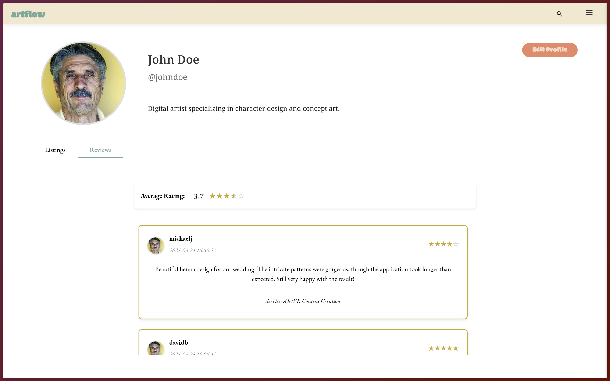
  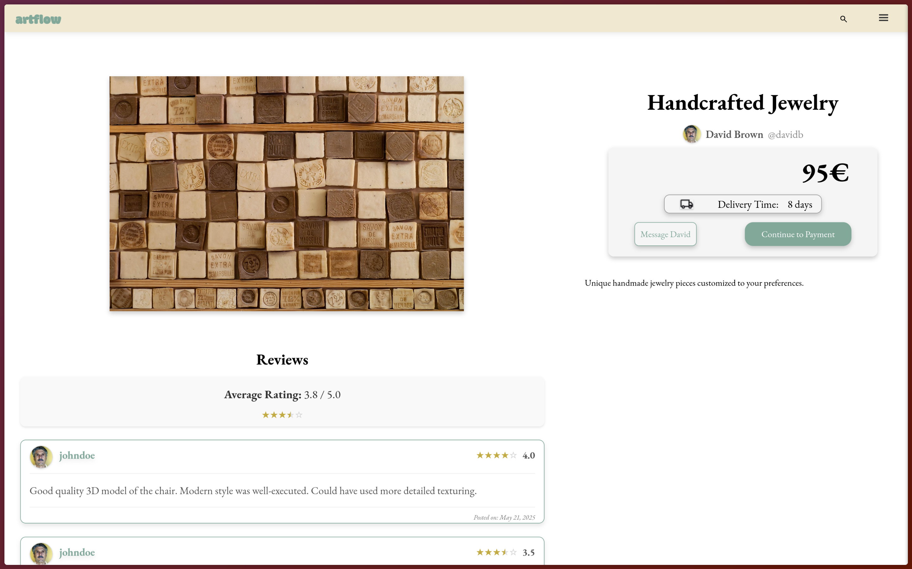
  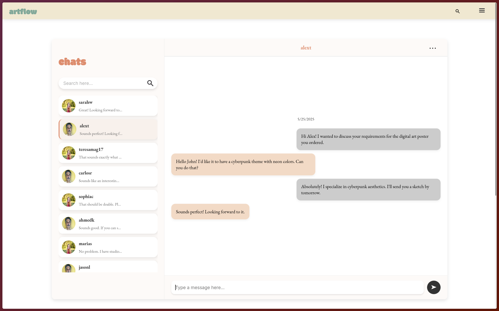
</div>
<br>
<div style="display: flex; justify-content: space-between;">
  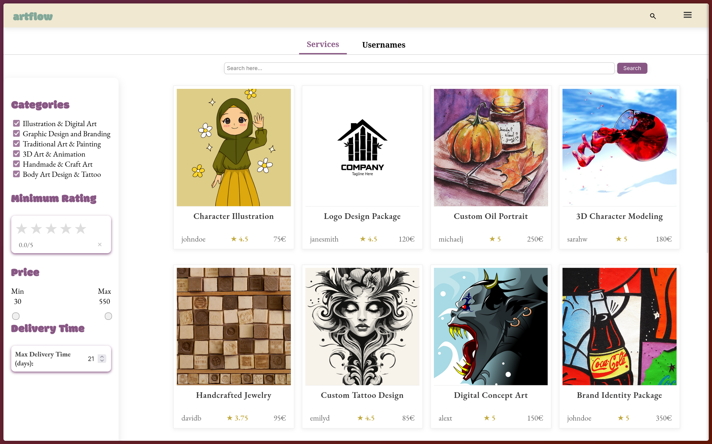
  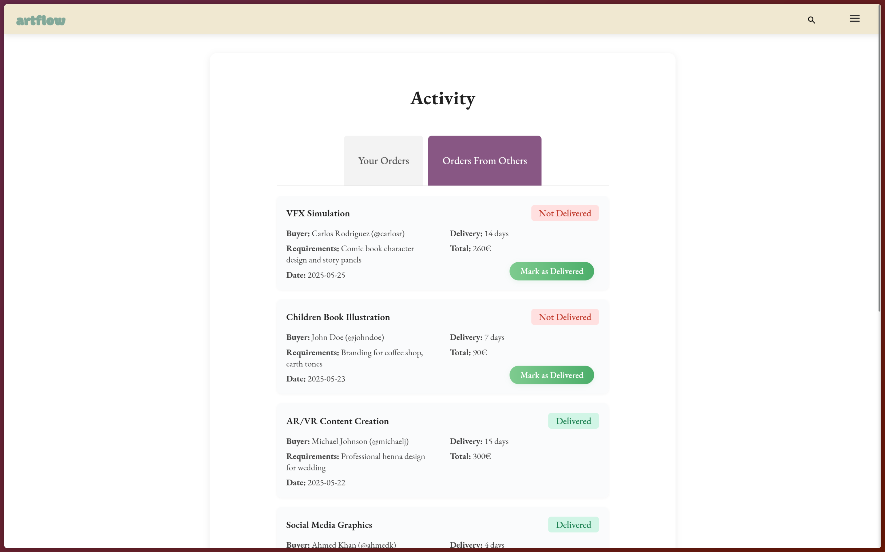
  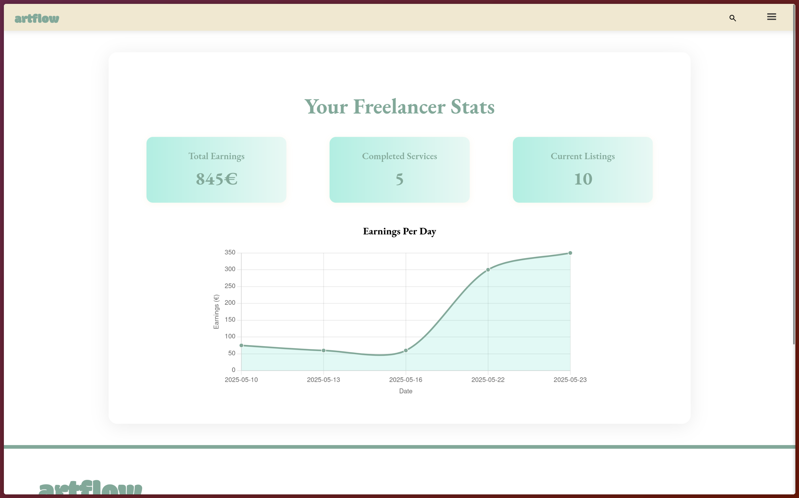
  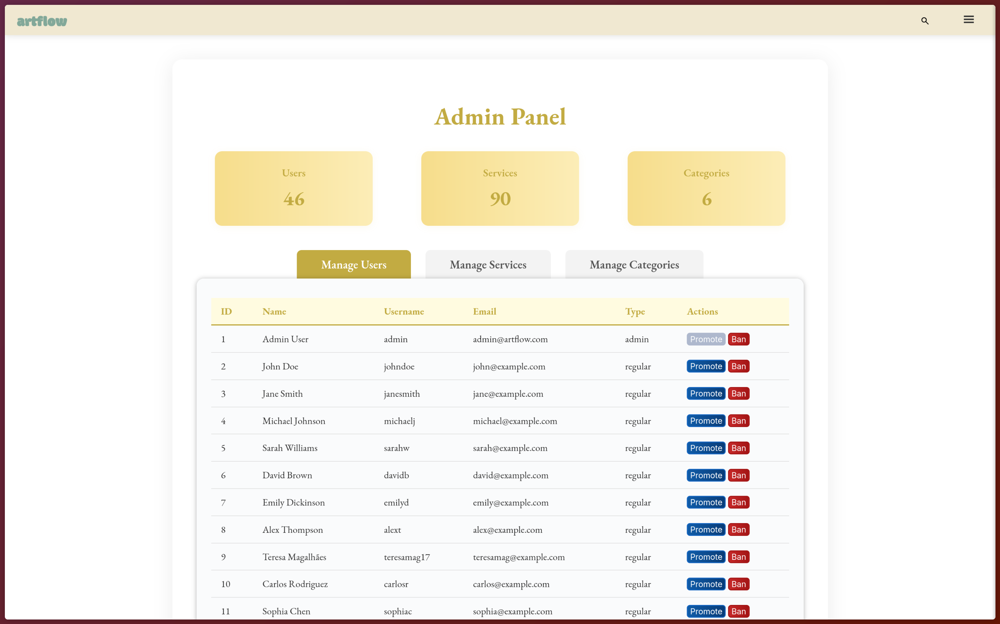
</div>
<br>
<br>

**Mockups:**

<div style="display: flex; justify-content: space-between;">
  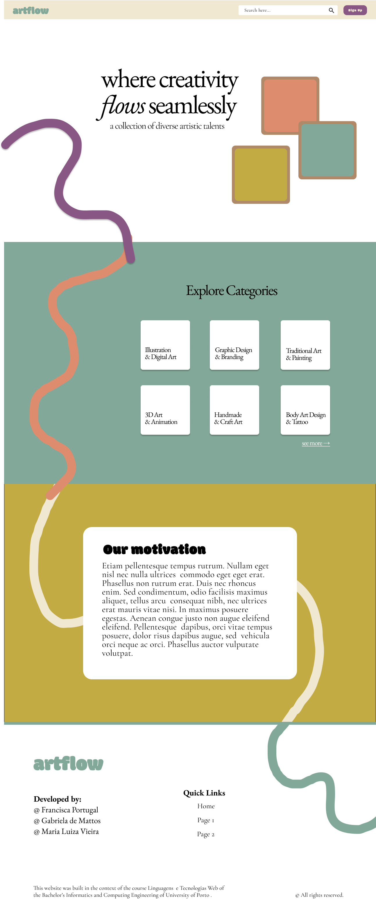
  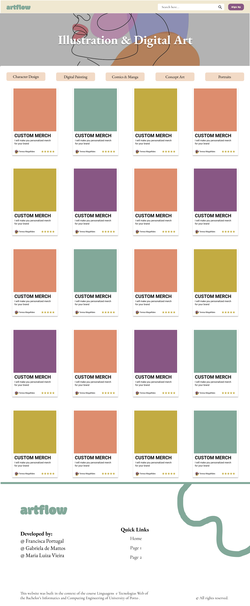
</div>
<br>
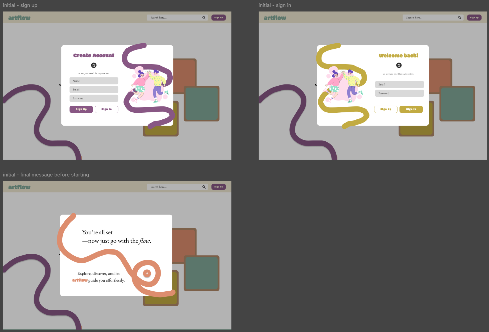
<br><br>

## How It Works

ArtFlow follows a structured MVC-inspired architecture with clear separation of concerns:

- **Database Layer:** SQLite database with comprehensive schema for users, services, orders, and messaging
- **Backend Processing:** PHP-based business logic and data processing
- **Frontend Interface:** Responsive HTML/CSS with JavaScript for interactive elements

Here is the illustrative class diagram of this site:
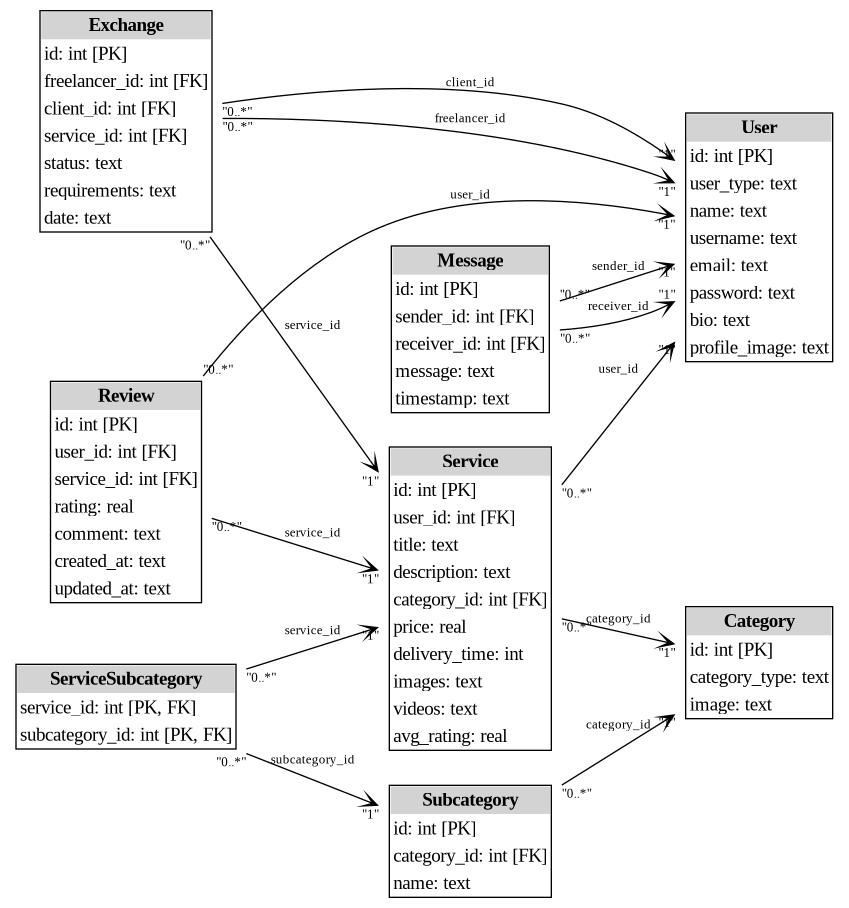

## Quick Start

1. Clone the repository

2. Set up the database

   ```
   cd database/
   sqlite3 database.db < database.sql
   sqlite3 database.db < populate.sql
   ```

3. Start the development server

   ```
   php -S localhost:9000
   ```

4. Access the application at `http://localhost:9000`

## Team & Course

**Team**

- <a href='https://github.com/franpts2'>Francisca Portugal</a>
- <a href='https://github.com/gab1demattos'>Gabriela de Mattos</a>
- <a href='https://github.com/maluviieira'>Maria Luiza Vieira</a>

**Course**

Developed for **Linguagens e Tecnologias Web (LTW)** at the Bachelor's in Informatics and Computing Engineering, University of Porto.

## License

Coursework submitted at FEUP. Shared for reference; all rights reserved unless stated otherwise.

---

_artflow — where creativity flows seamlessly._
